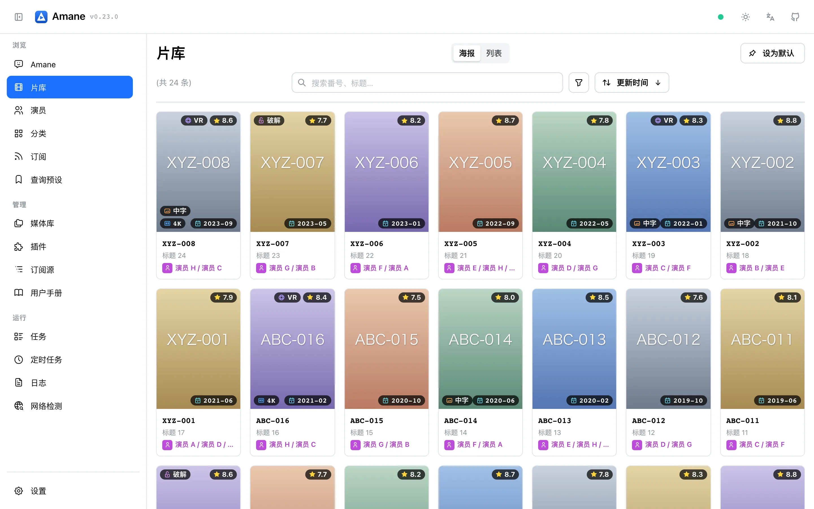

<div align="center">


# Amane

**AI 时代的私人影库**

多源刮削 · 元数据管理 · 字段级择优 · 数据私有 · 自托管服务 · 智能体协同 · 多端覆盖 · 开放扩展 · Emby / Jellyfin 适配

[](https://github.com/sqzw-x/amane/releases)
[](https://github.com/sqzw-x/amane/pkgs/container/amane)
[](https://sqzw-x.github.io/amane/)
[](LICENSE)

[用户文档](https://sqzw-x.github.io/amane/) · [下载](https://github.com/sqzw-x/amane/releases) · [更新日志](CHANGELOG.md) · [反馈问题](https://github.com/sqzw-x/amane/issues/new/choose)

</div>

---

Amane 是一个影片**元数据服务**, 核心是数据库中以番号为单位的影片条目. 番号可以手工输入、按模板批量生成、从 RSS 订阅中发现, 也可以由智能体或媒体库扫描提交.

Amane 不是 Emby / Jellyfin 的替代品, 而是它们的元数据补充: 媒体服务器负责媒体文件的管理、播放与串流, Amane 提供多源元数据, 并以 NFO 与图片的形式写到视频旁.

<picture>
  <source media="(prefers-color-scheme: dark)" srcset="docs/assets/screenshots/meta-wall-dark.webp">
  
</picture>

## 亮点

| | |
|---|---|
| **多源字段择优** | 内置 25 个影片站点, 按内容类型配置站点顺序, 每个字段可单独调整优先级或排除站点. |
| **完全数据所有权** | 各站点的原始结果、图片与译文都保存在本地 SQLite 与资源目录中; 来源站点下线后数据仍然可用, 重新刮削只请求缺失的站点. |
| **为管理而设计的界面** | 海报墙与多维筛选、对比来源、字段锁定、分类治理、评论与用户标签, 刮削结果可以逐字段审阅与修订. |
| **AI Native 设计** | 通过内置智能体使用自然语言检索片库、批量整理标签、发起刮削; 也可让外部智能体经 CLI 操作 Amane. |
| **多种番号来源** | 单个番号、模板批量生成、RSS 订阅、智能体、定时重新刮削, 以及可选的媒体库扫描. |
| **与媒体服务器互补** | 需要时把元数据整理为 NFO、海报、封面、剧照与字幕写到视频旁, Emby / Jellyfin 直接识别. |
| **多端适配** | 桌面版、Docker 与 Android 三种形态; 设置保存后立即生效; 升级时自动迁移数据库, 迁移前自动备份. |

## 开始使用

桌面版 (macOS / Windows) 与 Android 客户端见 [Releases](https://github.com/sqzw-x/amane/releases), Docker 镜像为 `ghcr.io/sqzw-x/amane`. 安装步骤、使用说明与常见问题见 [用户文档](https://sqzw-x.github.io/amane/).

## 社区生态

社区开发的外部工具与插件以 Issue 标签 [`eco:project`](https://github.com/sqzw-x/amane/issues?q=is%3Aissue+label%3Aeco%3Aproject) 收录. 这些项目由社区维护, 请自行评估其功能与安全性; 除公共 API 外, 本项目不提供支持与保证.

## 参与开发

缺陷与功能请求请使用 [Issue 模板](https://github.com/sqzw-x/amane/issues/new/choose). 提交 Issue 与 Pull Request 前请阅读 [AI_POLICY.md](AI_POLICY.md).

前置依赖: [uv](https://github.com/astral-sh/uv)、[pnpm](https://pnpm.io/)、[just](https://github.com/casey/just)

```bash
just setup   # 同步依赖并安装 hooks
just dev     # 启动 API (:8000) 与前端开发服务器
just check   # lint + typecheck + 测试
```

技术栈: FastAPI · React + Mantine · SQLite · Swift / .NET 桌面壳 · Kotlin Android 壳. 开发入口见 [AGENTS.md](AGENTS.md).

## 相关项目

- [yoshiko2/Movie_Data_Capture](https://github.com/yoshiko2/Movie_Data_Capture)
- [moyy996/AVDC](https://github.com/moyy996/AVDC)

## 许可证

[GPL-3.0](LICENSE)
