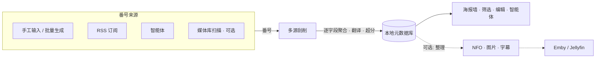

---
hide:
  - navigation
  - toc
---

# Amane

**AI 时代的私人影库**

Amane 是一个影片元数据服务, 核心是数据库中以番号为单位的影片条目. 给出一个番号, Amane 从多个站点刮削元数据, 逐字段择优后连同图片与译文保存在本地; Web 界面与智能体用于浏览、审阅和修订这份数据.

番号可以手工输入、按模板批量生成、从 RSS 订阅中发现, 也可以由智能体或媒体库扫描提交.

Amane 不是 Emby / Jellyfin 的替代品, 而是它们的元数据补充: 媒体服务器负责媒体文件的管理、播放与串流, Amane 提供多源元数据, 并以 NFO 与图片的形式写到视频旁.

[快速开始](user/index.md){ .md-button .md-button--primary }
[下载最新版本](https://github.com/sqzw-x/amane/releases){ .md-button }

## 核心能力

-   :material-layers-triple-outline:{ .lg .middle } **多源刮削**

    ---

    25 个内置影片站点, 按内容类型配置站点顺序, 每个字段可单独调整优先级或排除站点; 可选 LLM 翻译与图片超分.

    [:octicons-arrow-right-24: 刮削](user/scraping.md)

-   :material-database-lock-outline:{ .lg .middle } **数据留在本地**

    ---

    各站点的原始结果、图片与译文保存在本地; 来源站点下线后数据仍可用, 重新刮削只请求缺失的站点.

    [:octicons-arrow-right-24: 元数据缓存](user/scraping.md#cache)

-   :material-view-grid-outline:{ .lg .middle } **浏览与管理**

    ---

    海报墙与多维筛选、对比来源、字段锁定、分类合并与重命名、演员页、评论与用户标签.

    [:octicons-arrow-right-24: 片库与浏览](user/browse.md)

-   :material-robot-outline:{ .lg .middle } **智能体**

    ---

    用自然语言检索片库、批量修订、发起刮削; 外部智能体可经 CLI 接入.

    [:octicons-arrow-right-24: 智能体](user/agent.md)

-   :material-format-list-numbered:{ .lg .middle } **多种番号来源**

    ---

    单个番号、模板批量生成、RSS / Atom 订阅与定时重新刮削.

    [:octicons-arrow-right-24: 任务](user/tasks.md) · [订阅](user/feeds.md)

-   :material-puzzle-outline:{ .lg .middle } **插件**

    ---

    Python 插件扩展刮削来源与播放源, 安装后立即生效.

    [:octicons-arrow-right-24: 插件](user/plugins.md)

## 本地文件 (可选)

已有本地视频时, Amane 可以从文件名识别番号并刮削, 再把元数据写到视频旁供媒体服务器读取.

| 功能 | 说明 |
|------|------|
| [媒体库](user/libraries.md) | 扫描与监控目录, 从文件名识别番号并提交刮削 |
| [整理与路径模板](user/organize.md) | 按模板放置文件, 写出 NFO、图片、字幕与水印 |
| [对接 Emby / Jellyfin](user/media-server.md) | 推荐的媒体服务器配置, 库外链接与 STRM |
| [播放](user/playback.md) | 内置播放器, 播放源由插件提供 |

## 获取帮助

- [安装与快速开始](user/index.md): 各平台安装与首次使用
- [常见问题](user/faq.md): 按症状排查
- [GitHub Issues](https://github.com/sqzw-x/amane/issues/new/choose): 缺陷与功能请求
- [更新日志](https://github.com/sqzw-x/amane/blob/main/CHANGELOG.md): 各版本变更
